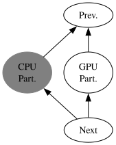
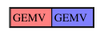
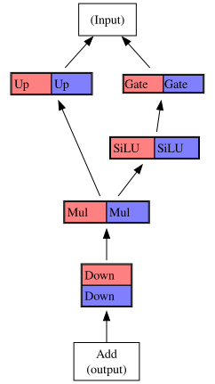

= Design
:stem: asciimath

== CPU and GPU Interactions
USM-TP implements tensor-parallel split routines
for GEMM and the forward pass of Qwen3 MLP.
In both cases,
a workload is split into 2 partitions,
assigned to the CPU and GPU.
The following sequence of events occurs
within a single split operation,
from the perspective of the host:

1. CPU and GPU synchronize.
   All prior work on GPU completes,
   and work queue is empty.
2. GPU partition is launched, asynchronously.
3. CPU partition is launched, synchronously.
4. The next GPU kernel (following the split operation) is launched.

The CPU partition of a split operation
depends on the preceeding GPU kernel.
This dependency is satisfied by the synchronization point (step 1).
On the other hand,
the GPU kernel succeeding the split operation
depends on the CPU partition.
This dependency is satisfied because the enqueue of the GPU kernel
occurs after the CPU partition completes (step 4).

Note that the split operations are synchronized
only with respect to the preceeding and succeeding GPU kernels.

The following depicts the dependencies between tasks involved in a split operation.
Tasks belonging to the split operation are labelled in **bold**.
Shaded nodes run on the CPU, and the rest on the GPU:

[.text-center]
 +

== Compute Kernels
Each of the partitions in a split operation is itself
a series of operations (e.g. GEMM) on a single device.
we rely on external libraries for
highly performant implementations of these operations.
OneDNN is used for the CPU, while
OneDNN and Aten/XPU (PyTorch's internal tensor library for the XPU backend)
are both used for the GPU.

== Split GEMM
The split GEMM borrows its splitting logic from Megatron-LM.
The weight matrix is split into 2 chunks along the column dimension,
and each partition computes the matrix product of one chunk with the input activations.
The results of the two partitions are concatenated along the column dimension.

[cols="1,1",%header]
|===
|Single-device
|Split

a|
stem:[Y = XW]

a|
[stem]
++++
W = [[W_a, W_b]]\
Y_a = XW_a\
Y_b = XW_b\
Y = [[Y_a, Y_b]]\
++++
|===

A highly simplified visual representation of the split GEMV:

[.text-center]

On a system with shared memory,
the splitting of the weight matrix and concatenation of the matrix products
do not require any data movement.

== Split Qwen3 MLP
The split Qwen3 MLP consists of 5 layers:
3 linear layers -- the gate- up- and down-projections --,
1 SiLU activation, and 1 element-wise multiplication.
It is parametrised on 2 sizes:
the hidden (a.k.a embedding) size H and intermediate size I.

The gate- and up-projections, SiLU and elementwise multiplication
are all partitioned along the column dimension.
For the projections (which are simply GEMM),
this is achieved by splitting the weight and output matrices,
as seen with the split GEMV.
For the SiLU and elementwise multiplication,
this is achieved by splitting all inputs and the output.

The down-projection is split along the row dimension.
This is achieved by splitting the input and weight matrices along their rows,
performing 2 GEMMs, and adding the results element-wise.
The extra addition step is performed after both partitions complete,
on a single device.

As described above, each operation is split into 2 parts.
Each partition of the split MLP executes 1 part of each operation --
for instance, the GPU might execute all blue blocks, and the CPU all red blocks.
This pattern of splitting allows each partition to complete without
waiting for the other partition at any point.

A task graph of the Qwen3 MLP is shown below,
along with the splitting of each layer.

[.text-center]

